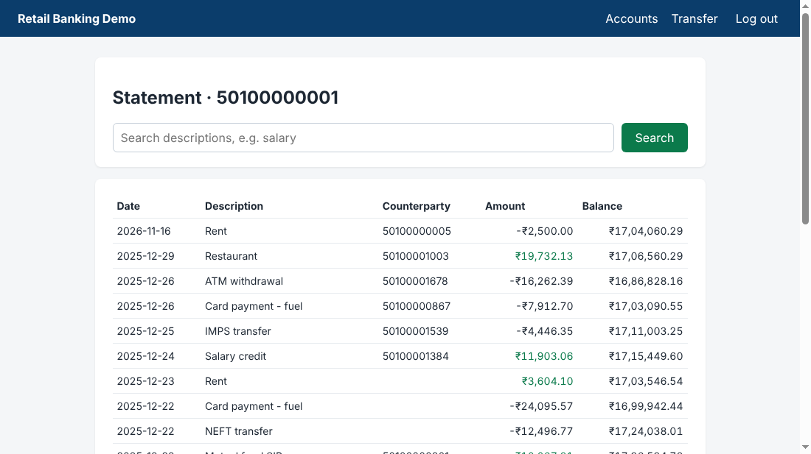
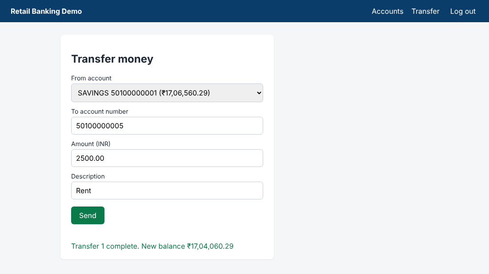

# Retail Banking Web App: FastAPI, Selenium Test Automation & Performance Tuning

[](https://github.com/adityaaviero47/banking-app-selenium-perf/actions/workflows/ci.yml)

A small but complete retail-banking web app (sign-in, accounts, statements with
search and pagination, fund transfers) built to answer three questions a bank's
technology team cares about:

1. **Is money safe?** Transfers are atomic, idempotent and race-free, checked
   by a test that fires 200 parallel transfers at one account.
2. **Does the UI work?** A Selenium suite drives a real headless Chrome through
   every user journey, using the Page Object pattern.
3. **Is it fast under load?** A load test against a 1-million-transaction
   ledger found the slow paths; tuning them cut p95 latency 10–37x.

| Statement | Transfer |
|---|---|
|  |  |

## Design

```
browser (HTML + vanilla JS) ──► FastAPI routes (api.py)
                                   │
                    services.py    AuthService · TransferService      business rules
                                   │
               repositories.py     AccountRepository · StatementRepository (ABC)
                                   │     ├─ BaselineStatementRepository
                                   │     └─ TunedStatementRepository
                                 SQLite
```

- **Object-oriented layers.** Routes only parse and authorise. Services hold
  the rules. Repositories hold the SQL. The two statement repositories share an
  abstract interface, so baseline and tuned versions are swapped with one
  setting (`BANK_MODE`) and compared on the same data.
- **Money as integer paise.** No floating-point balances anywhere.
- **Atomic transfers.** `BEGIN IMMEDIATE` takes the write lock before the
  balance is read, so two transfers can never both spend the same rupees.
  Debit, credit, both ledger rows and the transfer record commit together or
  not at all.
- **Idempotency keys.** Every transfer carries a client-generated key with a
  `UNIQUE` constraint, so a retry or a double click never charges twice.
- **Validation twice.** The browser checks amounts for instant feedback; the
  server checks them again because the browser can't be trusted.
- **Security basics.** PBKDF2 password hashes, HTTP-only `SameSite=Strict`
  session cookie, every account access checked against the signed-in
  customer, and all user text escaped before rendering. A Selenium test plants
  an XSS payload in a transfer description and checks it renders as text.

## Tests: 54, all passing

| Suite | Tests | What it checks |
|---|---:|---|
| `test_models.py` | 17 | Amount parsing: decimals, limits, junk input |
| `test_api.py` | 18 | Every endpoint, run against **both** baseline and tuned data layers: auth, ownership, transfers both sides, insufficient funds, idempotent retry, pagination with no gaps or duplicates, literal `%` in search |
| `test_concurrency.py` | 2 | 8 threads × 25 transfers on one account: never overdrawn, exactly as many succeed as the balance allows, total money conserved to the paisa, ledger matches balance |
| `e2e/test_ui.py` | 17 | **Selenium**, headless Chrome, Page Object Model: sign-in and wrong password, redirects when signed out, transfer updates both balances, insufficient funds, 4 client-side validation cases (with a database check that no request was sent), same-account rejection, double-submit charges once, statement search, "Load more" without duplicates, XSS rendered as text, logout |

The Selenium suite found a real bug on its first run: a wrong password returned
401, which the front end treated as "session expired" and reloaded the page,
wiping the error message before the user could read it. Fixed in `app.js`.

The E2E suite ran 3 times in a row with no flaky failures (17/17 each, about 19 s).

## Performance: profile, fix, measure

**Setup:** 1,000 customers, 1,812 accounts, **1,000,000 transactions**
(synthetic, seeded), with 20 busy business accounts holding about 20,000
transactions each. Load test: 20 concurrent virtual users per scenario for
15 s, against a single uvicorn process on a 2-core machine that also runs the
load generator.

### What the baseline did wrong

| Problem | Effect | Fix |
|---|---|---|
| No index on `transactions(account_id, ts)` | Every statement query scans all 1M rows and sorts (`SCAN transactions`, `USE TEMP B-TREE FOR ORDER BY`) | Composite index `(account_id, ts DESC, id DESC)`: `SEARCH t USING INDEX` |
| `OFFSET` pagination | Page 201 makes the database walk past 5,000 rows | Keyset pagination: `WHERE (ts, id) < (?, ?)` |
| Search filtered in Python | Loads the account's full history for every search | `LIKE` in SQL, with `%` and `_` escaped |
| N+1 queries | One extra query per row to look up the counterparty | One `LEFT JOIN` |
| New connection per request, rollback journal | Connection setup and an fsync on every commit | Per-thread connection reuse, WAL, `synchronous=NORMAL`, 64 MB page cache |

### Results

| Scenario | p95 before | p95 after | Speed-up | Throughput before → after |
|---|---:|---:|---:|---:|
| Statement, busy account, first page | 783 ms | 67 ms | **11.7x** | 33 → 561 req/s |
| Statement, busy account, page 201 | 963 ms | 65 ms | **14.9x** | 25 → 598 req/s |
| Statement search | 2,619 ms | 71 ms | **36.7x** | 11 → 498 req/s |
| Statement, ordinary account | 649 ms | 65 ms | **10.0x** | 39 → 572 req/s |
| Transfer | 235 ms | 42 ms | **5.6x** | 362 → 892 req/s |

- **Zero server errors** in either run.
- Across **18,840** completed load-test transfers, total money in the bank was
  unchanged to the paisa and no balance went negative.
- One honest trade-off: median transfer latency rose from 7.6 ms to 18.8 ms,
  because the tuned server handled 2.5x as many transfers in the same time
  through SQLite's single writer. The p95 and p99 tails improved
  (235 → 42 ms, 936 → 106 ms).

Raw numbers: [`results/load_baseline.json`](results/load_baseline.json),
[`results/load_tuned.json`](results/load_tuned.json).

## Run it

```bash
pip install -r requirements.txt
python -m app.seed bank.db 1000 1000000          # synthetic bank, about 20 s
BANK_DB=bank.db BANK_MODE=tuned uvicorn app.api:app --port 8000
# open http://127.0.0.1:8000 , customer ID 1, password Demo@1234

pytest -q tests                                   # all 54 tests (needs Chrome)
python perf/loadtest.py http://127.0.0.1:8000 bank.db results/load_tuned.json 20 15
```

For the baseline run, use a separate copy of `bank.db` without the index and
start the server with `BANK_MODE=baseline`.

## Limitations

- SQLite has one writer at a time; a production bank would use PostgreSQL or
  Oracle with row-level locks. The layering is the same; only the repository
  SQL would change.
- Sessions live in memory, so they reset on restart and won't work across
  several servers. A shared store such as Redis would fix that.
- All data is synthetic. The load generator shares the 2-core machine with the
  server, so absolute numbers are modest; the before/after ratios are the point.
- No CSRF token beyond `SameSite=Strict` cookies, and no rate limiting on sign-in.

## Layout

```
app/api.py            FastAPI routes and page serving
app/services.py       AuthService, TransferService (atomic, idempotent)
app/repositories.py   Database, AccountRepository, baseline and tuned StatementRepository
app/models.py         domain objects, errors, amount parsing
app/db.py             schema, connections, tuning (index, WAL, cache)
app/seed.py           synthetic 1M-transaction bank
app/static/           HTML, CSS, JS front end
tests/                unit, API, concurrency tests
tests/e2e/            Selenium suite: pages.py (Page Objects) + test_ui.py
perf/loadtest.py      async load generator, p50/p95/p99 and throughput
results/              load-test results, before and after
.github/workflows/    CI: unit + API + Selenium tests on every push
```
